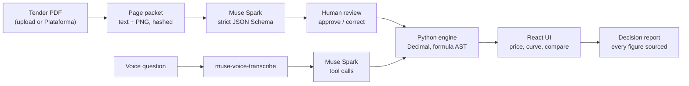

# BidLab

**From a Spanish public-tender PDF to a bid price you can defend.**

BidLab is a local-first assistant for small firms that bid on public contracts in Spain. Meta's **Muse Spark** reads the tender (text and page image) and proposes requirements with exact page citations. A person approves them. A deterministic Python engine then computes price, points and the abnormally-low-offer rule, and every figure in the final report points back to its page.

The interface is designed first for the people who actually make these decisions in small firms, many of them over 60: large type, AAA contrast, big targets, plain Spanish, and voice.

[](LICENSE)


> **Same 49/49 price points. €5,916.80 more profit.**
> On a real tender (Tías, expediente 2026/00006554N, €118,336 net budget), a 10 % and a 15 % discount score the same 49 of 49 price points. The 10 % bid keeps €5,916.80 more profit. Costs and rival bids in the example are declared hypotheses, labelled on screen; BidLab never predicts who wins.

---

## Why it matters

Spain publishes thousands of tenders a year on the Plataforma de Contratación del Sector Público. Each comes with long legal PDFs (PCAP, PPT) that decide who may bid and how price turns into points. Large firms have bid teams; a small firm usually has one person, often the owner, reading 40+ pages before a deadline. The two expensive mistakes are bidding when you are not eligible and giving away margin for points you would have scored anyway. BidLab targets both.

## What you can do

| Step | Screen | What happens |
|---|---|---|
| 1. Bring a tender | Nueva licitación | Paste a Plataforma de Contratación link or upload the PDF yourself. |
| 2. Let Muse Spark read it | Revisar | Opt-in analysis: requirements, budget and the price formula, each with page and quote. You approve or correct. |
| 3. Check eligibility | Requisitos | Met / not met / «Por verificar», never a guess. One click opens the exact quote. |
| 4. Ask what is unclear | Requisitos → Pedir aclaración | Muse Spark drafts the formal clarification question for the contracting body, citing the page. |
| 5. Try prices | Precio | Slider and curve: price, profit, points and abnormal-offer risk from the Python engine. Ask by voice: «¿y si bajo un 12 %?» |
| 6. Compare and decide | Informe | Saved trials side by side, Pareto frontier, a printable decision record with sources. |

Screens: [two-minute tour](docs/demo/README.md).

## How BidLab uses Meta

| Meta technology | Where | What it does in BidLab |
|---|---|---|
| **Muse Spark 1.3**, Meta Model API, text + page image in one request, strict JSON Schema output | [`services/meta_adapter.py`](apps/api/bidlab/services/meta_adapter.py), [`services/jobs.py`](apps/api/bidlab/services/jobs.py) | Extracts observations from a bounded page packet. Every answer is re-validated, bound to the pages and image ids that were sent, and stored with its receipt (model, request id, tokens, cost, latency). |
| **Muse Spark**, structured drafting | [`services/clarification.py`](apps/api/bidlab/services/clarification.py) | Writes the clarification question for an open requirement. The prompt is built server-side from one stored citation; the draft must echo that page and quote or it is rejected. |
| **muse-voice-transcribe** + **Muse Spark tool calling** | [`services/assistant.py`](apps/api/bidlab/services/assistant.py) | «Pregúntale al pliego»: speak a question, the model answers by calling BidLab's own engine and citation tools. Every number in the answer must come from a tool result. |
| **Muse Code** | [`AGENTS.md`](AGENTS.md) | BidLab was built with Meta's coding agent. `AGENTS.md` is the instruction file it worked from: invariants, gates and the honesty rules below. |

**Guardrails around every model call**

- **The model proposes, Python decides.** No model output reaches a price, a point or an eligibility verdict without a person approving it; arithmetic lives in [`domain/`](apps/api/bidlab/domain) with `Decimal`, and the frontend never recomputes it.
- **Strict schema preflight** before any payload is built ([`meta_schema_preflight.py`](apps/api/bidlab/services/meta_schema_preflight.py)): closed objects, bounded depth, the provider's strict-mode rules.
- **Bounded spend.** Each call reserves budget first, is sent once (no retries) with an explicit output cap, and settles against reported usage ([`services/budget.py`](apps/api/bidlab/services/budget.py)).
- **Untrusted documents.** Tender text is data, never instructions. The adversarial corpus includes a prompt-injection page.
- **Honest states.** Without a key the app answers `503 provider_not_configured`; the offline demo is labelled «Datos de ejemplo» and never claims a model run.

**Live evaluation** (30 Oct 2026, `muse-spark-1.3-contributor`, [details](docs/META_EVIDENCE.md)): 12 of 12 synthetic adversarial tenders extracted (scanned page, tables, contradictions, lots, extensions, ambiguous formula, injection attempt), 18 of 18 cited figures checked by a person against the PDF, 0 critical errors, $0.013 total spend. The corpus and gold answers are public in [`examples/meta_eval_synthetic/`](examples/meta_eval_synthetic).

## Architecture



FastAPI + Pydantic v2 + SQLAlchemy 2 + SQLite (WAL, one process on loopback). React 19 + TypeScript + Vite + Tailwind v4 + TanStack Query. PDFs: pypdf for text, PyMuPDF for page renders. Full description: [docs/ARCHITECTURE.md](docs/ARCHITECTURE.md) (implementation section first), math: [docs/RULE_ENGINE.md](docs/RULE_ENGINE.md).

## Designed for older readers

The design rules live as one commented block at the top of [`apps/web/src/styles.css`](apps/web/src/styles.css):

- **Reading floor.** Nothing a user must read is under 16 px; body text is 18 px. One button enlarges everything by 12.5 %.
- **Typeface.** [Atkinson Hyperlegible Next](https://www.brailleinstitute.org/freefont/) (Braille Institute, for low-vision readers), with plain-zero figures from Inter so euro amounts never show «Ø».
- **Contrast and targets.** Text at WCAG AAA (7:1), form borders at 3:1, every control at least 48 px.
- **Recognition over recall.** Five numbered steps always visible, one idea per card, the same word for the same action everywhere ([copy style guide](docs/copy-style-es.md), [voice guide](docs/voice-guide-es.md)).
- **No colour-only signals, reduced motion respected, keyboard and screen-reader paths** tested with axe in the E2E suite.

## Design decisions worth reading in the code

- [`services/meta_adapter.py`](apps/api/bidlab/services/meta_adapter.py): one honest gate between an offline stub and the live API; failures are typed, never replaced by fixtures.
- [`services/clarification.py`](apps/api/bidlab/services/clarification.py): why the model only drafts wording and how its output is bound to the evidence it was given.
- [`domain/expressions.py`](apps/api/bidlab/domain/expressions.py): price formulas as a whitelisted AST, never `eval`.
- [`services/decision_frontier.py`](apps/api/bidlab/services/decision_frontier.py): Pareto frontier over saved trials, compared only within one frozen context.
- [`features/requirements/ClarificationPanel.tsx`](apps/web/src/features/requirements/ClarificationPanel.tsx): consent that names exactly what leaves the computer.

## Run it

Requires Python 3.12+, [uv](https://docs.astral.sh/uv/), Node 20.19+ and npm.

```bash
uv sync --all-packages
npm install
npm run build
python scripts/demo.py --reset-demo
```

Open <http://127.0.0.1:8000/> and press «Cargar ejemplo». The curated demo runs fully offline with no API key.

**Live Meta features** (analysis, clarification drafts, voice): copy `.env.example` to `.env`, then

```bash
BIDLAB_MODE=live
MODEL_API_KEY=<your Meta Model API key>
META_API_URL=https://api.meta.ai/v1/chat/completions   # process environment
BIDLAB_META_BUDGET_USD=5.00                            # hard ceiling for all calls
```

`GET /api/v1/capabilities` then reports `meta_configured: true`. Every live call asks for consent in the UI first.

## Verify

```bash
python scripts/verify.py        # every gate below; exit 0 = green
```

pytest (unit, integration, contracts), ruff, mypy, ESLint, `tsc`, Vitest, Vite build and the Playwright E2E suite (Chromium against the real API, loopback-only network guard, axe accessibility checks).

## Limits

- Single-user, local-first: loopback API, no authentication. Not a hosted multi-tenant service.
- Supported price formulas are templates (proportional inverse and others in [RULE_ENGINE](docs/RULE_ENGINE.md)); other formulas are flagged, not guessed.
- Rival bids are declared hypotheses. There is no win-probability model, and the abnormal-offer rule is shown as a legal presumption that needs justification, never as an automatic exclusion.
- The live evaluation covers a synthetic adversarial corpus; coverage of arbitrary real tenders is not claimed.

## Repository map

```
apps/api/bidlab/   domain/ (pure Decimal engine) · services/ (Meta, jobs, intake, compare) · api/ (routes)
apps/web/src/      features/ (workspace, requirements, pricing, report, review, intake, assistant)
docs/              ARCHITECTURE, RULE_ENGINE, DATA_MODELS, API_CONTRACT (generated), META_EVIDENCE, demo/
examples/          synthetic Meta evaluation corpus + gold answers, math vectors
tests/e2e/         Playwright suite (hermetic, loopback-only)
video/             the 180 s demo video as code (Playwright captures + Remotion)
```

## Resumen en español

BidLab ayuda a una pyme a decidir si se presenta a una licitación pública y a qué precio. Muse Spark, el modelo de Meta, lee el pliego y propone los requisitos con su página. Tú los apruebas. Un motor en Python calcula precio, puntos y oferta anormalmente baja. Cada cifra del informe lleva su cita. La interfaz está pensada para personas mayores: letra grande, alto contraste, botones grandes y preguntas por voz.

## License

[MIT](LICENSE) © 2026 iggykimi
