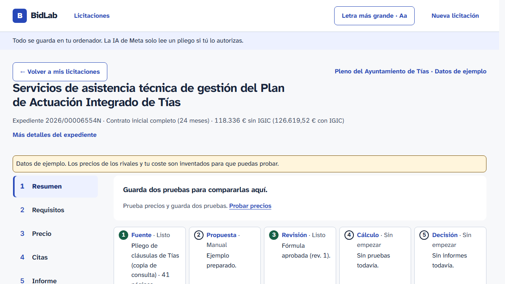
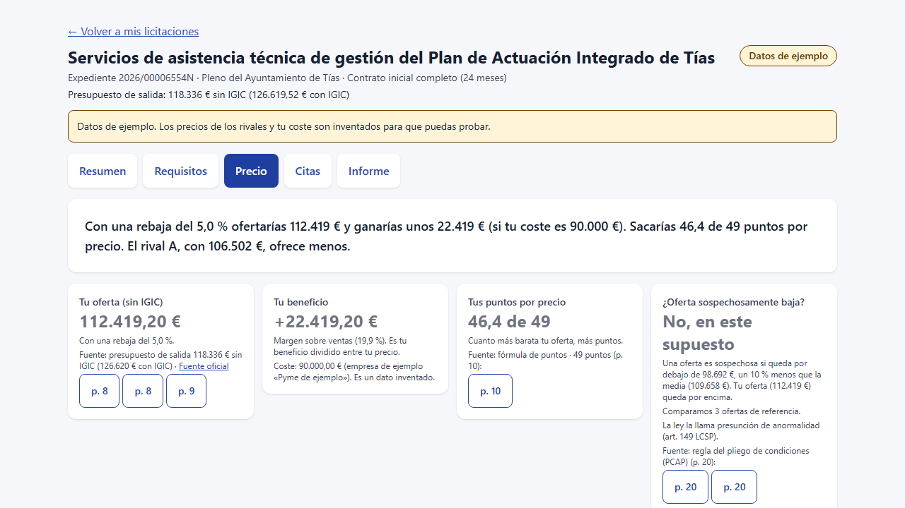

# Pack de demo para revisores (humanos o modelos)

BidLab ayuda a una pyme a decidir si pujar a una licitación: lee el
pliego, extrae requisitos con citas por página y simula precios con un
motor determinista. Caso real: licitación 2026/00006554N del
Ayuntamiento de Tías (Lanzarote).

## Ver en 2 minutos (sin instalar nada)

Capturas regeneradas el 29-oct-2026 (post-issue #1) con
`npx playwright test -c scripts/demo-shots/playwright.shots.config.ts`
(base separada de la suite E2E, nombres legibles, UI asentada):
tuteo, «Datos de ejemplo», comparar desde «Precio», drawer con
aviso honesto sin imagen (T15), radar con ejemplo sintético (T20, 09)
y techo de coste en la malla (T21, 10).

| Pantalla | Qué demuestra |
|---|---|
| [01-resumen.png](01-resumen.png) | Resumen: plazo, presupuesto, qué puntúa |
| [02-precio.png](02-precio.png) | Precio: conclusión, puntos, anormalidad |
| [03-curva.png](03-curva.png) | Curva precio→puntos con rivales supuestos |
| [04-citas.png](04-citas.png) | Citas verificables contra el pliego |
| [05-requisitos.png](05-requisitos.png) | Matriz de requisitos (cumple / no / sin datos) |
| [06-informe.png](06-informe.png) | Informe exportable con fuentes y pendientes |
| [07-evidencia-drawer.png](07-evidencia-drawer.png) | Panel de evidencia con página del pliego |
| [08-movil.png](08-movil.png) | Móvil: no rompe (desktop-first, sin diseño móvil dedicado) |
| [09-radar.png](09-radar.png) | Revisar: radar sin pares + ejemplo sintético rotulado (T20) |
| [10-techo.png](10-techo.png) | Malla: techo de coste con disclaimers (T21) |




## Probar en 5 minutos

```sh
uv sync --all-packages && npm install
python scripts/demo.py --reset-demo   # API + semilla demo
npm run dev -w apps/web               # web en 127.0.0.1:5173
```

Abrir <http://127.0.0.1:5173/>, botón demo → workspace `/tenders/tias`.
Sin claves ni red: la demo es 100 % offline (los E2E abortan cualquier
petición no-loopback). Guion de 180 s: [demo-script-180s](../demo-script-180s.md).
Caso oro: rebajas del 10 % y del 15 % dan los mismos 49 puntos, pero el
10 % conserva 5916,80 € más de beneficio (fijado por CMP-02).
Recorrido propio offline: «Nueva licitación» → alta + PDF + empresa +
análisis + revisión manual + simular + comparar + exportar
(fijado por tests/e2e/own-journey.spec.ts).

## Dónde mirar el código

- Motor determinista (precio, puntos, presunción de anormalidad 18.5):
  `apps/api/bidlab/domain/` + `services/evaluation.py`
- Contratos API: `docs/API_CONTRACT.yaml`
- Frontend (React, español claro, guía de voz): `apps/web/src/`,
  textos centralizados en `lib/` + [voice-guide](../voice-guide-es.md)
- Tests (contados el 29-oct-2026 en este árbol, ver
  [verification-log](../verification-log.md)):
  backend 557 + 2 skipped (unit + evaluation + integración/contratos),
  web 252 en 33 ficheros (`npm run test:unit`),
  E2E 85 herméticos (Chromium, loopback).
  Puertas completas en verde el 29-oct
  (`python scripts/verify.py`, 10/10) + dos ensayos
  limpios R1+R2.

## Evidencia de calidad

- Puertas locales (sin CI remota, por decisión del autor):
  `uv run python scripts/verify.py` → 10 puertas (deps, pytest unit,
  pytest integración+contratos, eslint, tsc, build, vitest, ruff,
  mypy, Playwright): ALL CHECKS PASSED, exit 0, el 29-oct
  (tour + malla + contrato stress incluidos).
- Log de verificación con evidencia real: [verification-log](../verification-log.md).
- Auditoría UX externa aplicada: [ux-review](../ux-review.md).

## Límites honestos (no fingimos más)

- Un tender real (Tías); precios de rivales y costes, sintéticos y rotulados.
- Sin todas las ofertas reales no hay predicción de adjudicación.
- `unknown` es `null`, nunca cero; la anormalidad es presunción, no exclusión.
- Sin Meta en vivo en el frontal (solo smoke backend); empresa y rivales
  sintéticos; sin predicción.
- Histórico P1 aparcado; móvil solo "no rompe"; sin `LICENSE` aún (T32).
- Footage real sin narración ([footage-oro-20261028.webm](footage-oro-20261028.webm), flujo oro, regrabado post-paquete con UI actual); vídeo narrado pendiente; sin envío (pendiente del autor).

## Qué feedback nos sirve

1. ¿La conclusión de cada pantalla se entiende en 5 segundos?
2. ¿Algún número sin redondear, jerga sin explicar o contraste pobre?
3. ¿El motor de precio/anormalidad tiene algún caso borde mal tratado?
4. ¿Qué quitarías para simplificar (menos es más)?
